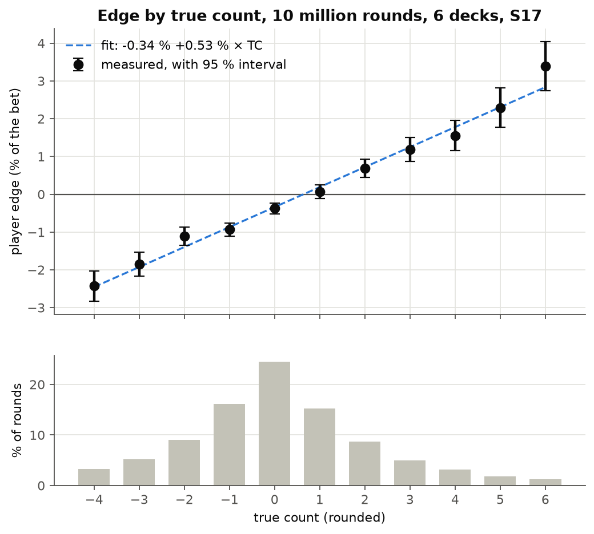
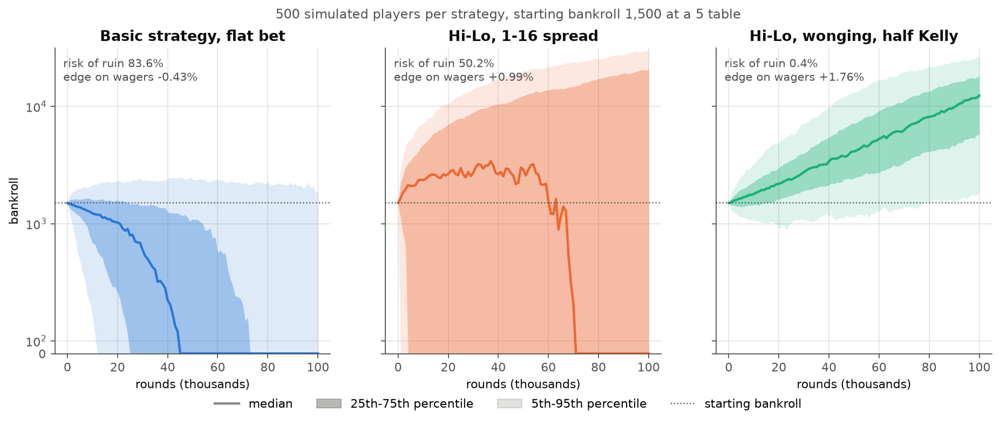
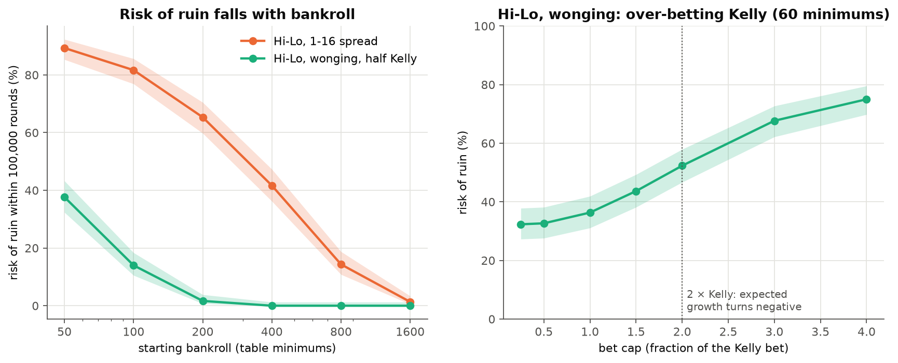

# Card counting under a Monte Carlo microscope

[](https://github.com/Nic0lasmurat0re/blackjack-card-counting/actions/workflows/tests.yml)

A blackjack simulator built to answer a risk question: **does a positive edge make a
player profitable?** It measures the edge that Hi-Lo card counting gives at each true
count, sizes bets with the Kelly criterion, then runs hundreds of simulated players
over 100,000 rounds to estimate their distribution of outcomes and their risk of ruin.

*Personal project, Nicolas Muratore, 2025–2026.*

## Key results

Three players start with the same bankroll of 1,500 at a table with a minimum bet of
5, which is 300 minimum bets. Each simulation runs until the player is ruined or has
played 100,000 rounds, about 1,000 hours of play. There are 500 players per strategy.

| Player | Edge on money wagered | Median final bankroll | Players ahead | Risk of ruin (95 % CI) |
|---|---|---|---|---|
| Basic strategy, flat bet | −0.43 % | ruined (< 5) | 8 % | 83.6 % [80.1, 86.6] |
| Hi-Lo, bets spread 1 to 16 units | **+0.99 %** | ruined (< 5) | 50 % | **50.2 %** [45.8, 54.6] |
| Hi-Lo, wonging, bets capped at half Kelly | +1.76 % | 12,389 | 96 % | 0.4 % [0.1, 1.4] |

- **A positive edge is not enough.** Spread counters win about one percent of the
  money they wager, yet half of them go broke. Raising bets sixteen-fold on
  good counts multiplies the variance, and 300 units cannot absorb it.
- **Bet sizing is what controls risk.** Sitting out bad counts (wonging) and capping
  each bet at half the Kelly bet raises the edge to +1.76 % and cuts the risk of ruin
  to 0.4 %.
- **Over-betting is punished.** Past twice the Kelly bet, expected log-growth turns
  negative: the median player is ruined, as theory predicts.
- **The edge model holds.** Over 10 million rounds, the player edge is
  −0.34 % + 0.53 % per point of true count, with a break-even point at +0.64. These
  are the coefficients used to size the Kelly bets.

## Figures

**Edge by true count.** Measured on 10 million flat bets, with 95 % intervals. Below:
how often each count occurs. Counts of +2 or more, where the player has a real edge,
occur in only one round in five.



**Distribution of outcomes.** The median and the 25-75 % and 5-95 % percentile bands
of 500 bankroll paths per strategy, on a log scale.



**Risk of ruin.** Left: the bankroll each strategy needs. The spread counter still has a
1.3 % risk of ruin with 1,600 minimum bets. The half-Kelly wonger is at 1.7 % with
200, and none of its 300 players was ruined with 400.
Right: risk of ruin as bets grow past the Kelly bet. Below one Kelly the curve
flattens around 32 %. With only 60 minimum bets, the Kelly bet is often smaller than
the table minimum, so the player is forced to over-bet whatever fraction is chosen.



## Model

**Rules.** Six decks, 83 % penetration, dealer stands on soft 17, blackjack pays 3:2,
double after split, no re-split, no surrender, dealer peeks for blackjack.

**Counting.** Hi-Lo: +1 for 2 to 6, 0 for 7 to 9, −1 for tens and aces. The true count
is the running count divided by the decks left in the shoe. The dealer's hole card is
counted only once it is revealed.

**Playing.** Basic strategy from the Blackjack Apprenticeship charts; the tests check
every cell of the hard, soft and pair tables. Counters add the Illustrious 18 index
plays, splitting tens at high counts, and insurance from a true count of +3.

**Betting.** The Kelly bet for an edge e and a round variance σ² is a fraction e / σ²
of the bankroll. The edge comes from the linear model above, and σ² = 1.32 is measured
too. The wonging player bets on a 1-2-4-8-12-16 unit ramp, capped at half that Kelly
bet. Bets are whole multiples of the table minimum and never exceed the bankroll.
The player joins a shoe at a true count of +1.5 and leaves below +1; these thresholds
loosen as the bankroll grows.

**Ruin** means the bankroll can no longer cover the table minimum.

**Simplifications.** Rounds the wonger sits out show between 4 and 7 cards. Casinos
are assumed to tolerate wonging and large bet spreads, which they generally do not.

## Using it

```python
from bjsim import COUNTER_WONGING, BlackjackGame

result = BlackjackGame(COUNTER_WONGING, initial_bankroll=1500, seed=0).simulate(100_000, unit_bet=5)
print(result.final_bankroll, f"{result.expected_value:+.2%}", result.ruined)
```

A `Player` is a small dataclass, with fields `deviations`, `ramp`, `wonging` and
`kelly_fraction`, so another betting policy is one line away.

```
src/bjsim/
  cards.py        cards and the shoe (seeded, cut card)
  strategy.py     basic strategy and the Illustrious 18
  game.py         one round, betting policies, simulate()
  montecarlo.py   independent players in parallel, Wilson intervals
scripts/          one script per figure, each printing its numbers
tests/            459 tests: strategy charts cell by cell, stacked-deck rounds, counting, betting
```

```bash
git clone https://github.com/Nic0lasmurat0re/blackjack-card-counting.git
cd blackjack-card-counting
python -m venv .venv && source .venv/bin/activate
pip install -e ".[test]"

pytest                              # under a second
python scripts/edge_by_count.py     # 10 million rounds
python scripts/players.py           # 1,500 simulated players
python scripts/risk_of_ruin.py      # 6,000 simulated players; a few minutes in all on 8 cores
```

Results are reproducible: every simulated player has its own seed. The engine plays
about 175,000 rounds a second per core.

## License

[MIT](LICENSE)
